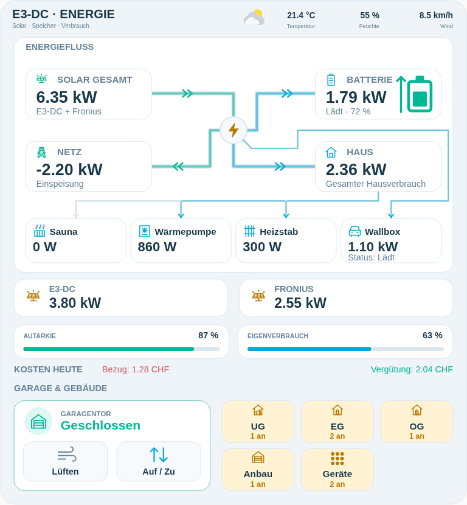

# Energie- und Hausübersicht

PV, Netz, Batterie, Hausverbrauch, Wetter und Haussteuerung in einer Lovelace-Karte. Die Karte erscheint in HACS als **Dashboard**.

## Voraussetzungen

- **Button Card** für die Darstellung und Bedienung, geprüft mit Version 7.0.1. [custom-cards/button-card](https://github.com/custom-cards/button-card)
- **Browser Mod 2** für die Pop-ups. Nach der Installation muss die Integration in Home Assistant eingerichtet sein. [thomasloven/hass-browser_mod](https://github.com/thomasloven/hass-browser_mod)

Die Karte verwendet bereits vorhandene Home-Assistant-Entitäten. Übersicht und Messwerte werden im Dashboard angezeigt, sobald die Entitäten zugeordnet sind.

## Über HACS installieren

1. Suche in HACS nach **Energie- und Hausübersicht**. Falls die Karte noch nicht angezeigt wird, öffne **HACS → ⋮ → Benutzerdefinierte Repositorys**, füge `https://github.com/marcofeurer/energie-dashboard-card` hinzu und wähle die Kategorie **Dashboard**.
2. Öffne die Karte in HACS und wähle **Herunterladen**. Lade das Dashboard anschließend neu.
3. Öffne **Dashboard bearbeiten → Karte hinzufügen** und wähle **Energie- und Hausübersicht**.

## Entitäten visuell zuordnen

Öffne **Dashboard bearbeiten → Karte bearbeiten** und klappe die gewünschte Gruppe auf. Die Entitäten sind in **Energie**, **Wetter**, **Garagentor**, **Untergeschoss**, **Erdgeschoss**, **Obergeschoss**, **Anbau** sowie **Geräte und Automationen** gegliedert.

Suche in den Feldern nach Anzeigenamen oder Entitäts-ID. Bereits gespeicherte Zuordnungen erscheinen im Editor. Wenn du ein Feld leerst, verwendet die Karte dort wieder ihre Platzhalter-ID. Du kannst dieselben Zuordnungen auch im YAML-Editor bearbeiten. [Beispielkonfiguration](example.yaml)

Die Kartenbereiche für Garage, Stockwerke und Geräte verwenden die zugeordneten Schalter, Lichter und Automationen. Der Wetterbereich liest die zugeordnete `weather.*`-Entität. Die Anzeige der Kosten übernimmt das Währungsformat CHF aus der Vorlage.

## Fehlersuche

Wenn Home Assistant meldet, dass der Kartentyp fehlt, lade die Seite neu und prüfe unter **Einstellungen → Dashboards → ⋮ → Ressourcen**, ob `/hacsfiles/energie-dashboard-card/energie-dashboard-card.js` als **JavaScript-Modul** eingetragen ist. Bei YAML-verwalteten Dashboard-Ressourcen ergänze die URL in deiner YAML-Ressourcenliste.

[HACS-Dokumentation für Dashboard-Repositorys](https://www.hacs.xyz/docs/publish/plugin/) · [Benutzerdefinierte Repositorys](https://www.hacs.xyz/docs/faq/custom_repositories/)

## Lizenz

Die Karte steht unter der [MIT-Lizenz](LICENSE).
